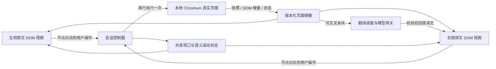

# 网页双语对照：产品与技术设计

日期：2026-10-08。状态：调研与方案草案，未进入实现。

## 1. 结论与已确认边界

目标是让用户在同一个网页状态下对照阅读两种语言，并从任意一侧继续操作。应新增「网页」工作区，与现有 PDF 工作区并存。

**建议验证的主路线：一个真实浏览器会话 + 两个受控 DOM 视图 + 独立翻译层。** 网页脚本和业务请求只在真实浏览器里执行；左右视图消费相同状态，右侧仅应用译文。两侧操作均回传真实会话，避免两个独立网页重复请求、状态分叉。

这是一项需要原型验证的架构提案，不能依据组件文档就承诺通用网站兼容。最短路径是先验证渲染镜像和交互闭环，再建设完整任务系统。

以下两项已由用户确认，作为本版设计依据：

| 决策 | 已确认范围 | 对路线的影响 |
| --- | --- | --- |
| 首批网站 | 公开文章、技术文档、产品页面 | 继续现有本地 Web 产品，增加本地 Chromium 服务；若登录态必需，优先评估扩展作为会话入口 |
| 排版一致性 | 保留样式、结构、图片和组件关系，允许译文自然换行 | 使用 DOM 译文回填和语义滚动；若要求像素级一致，需要另立视觉覆盖方案及质量标准 |

「登录后的复杂应用」和「严格像素一致」都会改变核心成本，不能当作普通增量需求。

## 2. 项目现状与可复用部分

依据当前仓库代码，而非旧 PRD 的规划：

| 现状 | 对网页模式的含义 |
| --- | --- |
| React 19 + TypeScript + Vite；`src/App.tsx` 集中管理上传、PDF 任务与缩放 | 可复用工作台外壳和语言选择；先拆 PDF 工作区，再新增网页工作区 |
| `src/PdfCanvas.tsx` 使用 PDF.js canvas 绘制，左右共享一个 zoom 状态 | 可复用同步缩放的产品习惯；canvas 渲染链路不适合承载 HTML 交互 |
| Python `ThreadingHTTPServer`，主要逻辑在 `server/app.py` | 当前没有 WebSocket、浏览器会话管理、DOM 捕获或网页翻译服务 |
| PDF 翻译客户端由 `EngineRuntime.get_translator()` 创建，依赖 pdf2zh/BabelDOC 设置 | 模型配置可以沿用；网页翻译不能直接挂在 PDF 引擎对象上 |
| `server/request_gate.py` 已实现限流、前台优先与等待老化；`src/latest-request.ts` 丢弃过期响应 | 可复用调度思想和响应所有权；需改为网页块/会话粒度 |
| 后端启动会预热 PDF 版面模型 | 网页模式启动不应被 PDF 模型加载阻塞；两个引擎按需启动 |
| 当前是本地个人 MVP | 第一阶段保持本地运行；云端浏览器池、多租户和计费另行评估 |

本轮只新增设计文档，不改业务代码。

## 3. 产品定义

### 3.1 用户任务

输入网址和目标语言后，在熟悉的原站视觉中读懂内容；滚动、展开、切换标签、跟随链接时，两侧一直停留在相同内容和状态上。

「整个网页」的首版定义：正文以及页眉、导航、按钮、菜单、弹窗等可访问 DOM 文本。不是只抽取正文重排成阅读器；也不意味着所有图片文字、视频字幕和 Canvas 绘制文字均可翻译。

### 3.2 主流程

1. 选择「网页」，输入 URL，目标语言默认简体中文，源语言默认自动检测。
2. 打开会话，尽早显示左侧原文；右侧显示同一版面并标明「正在翻译」，逐块出现译文。
3. 优先翻译当前可见内容、导航和即将进入视口的内容；长页面继续浏览时增量翻译。
4. 任一侧滚动、缩放或操作受支持组件，另一侧跟随对应内容和状态。
5. 跟随链接或 SPA 路由时，两侧一起切换；已翻译且内容未变的块复用缓存。
6. 切换目标语言保留会话和阅读位置，仅替换译文层。
7. 退出释放浏览器资源。历史链接恢复代表重新打开网站，不承诺恢复已失效的业务状态。

### 3.3 工作区草图

```text
TransFlow    [ PDF | 网页 ]
←  →  刷新  [ https://example.com/docs/                 ] [打开]
自动检测 → 简体中文       联动：开       视图缩放：100% / 适应宽度
┌──────────────────────────┬──────────────────────────┐
│ 原文 · English           │ 译文 · 简体中文           │
│ 原站导航、图片、正文     │ 对应导航、图片、译文     │
│ 原站组件状态             │ 同一组件状态             │
│                          │ 当前视口：部分翻译完成   │
└──────────────────────────┴──────────────────────────┘
连接正常 / 正在同步 / 部分区域无法还原             重试失败翻译
```

- 默认左右等宽。为保证相同响应式断点，首版不提供任意改变两侧逻辑宽度的分隔线。
- 联动默认开启；关闭后允许独立滚动查阅，但网站业务状态仍共享。重新开启时，以最后操作侧的可见块为锚点。
- 不显示无法计算的「全站翻译百分比」。动态页面只能可靠统计当前已发现文本块或当前视口的覆盖率。
- 尚未翻译的块可暂留原文，但要标明进行中；失败块保留原文并提供重试，不能伪装成已翻译。

### 3.4 首版能力合同

| 行为/内容 | 首版目标 | 不承诺的部分 |
| --- | --- | --- |
| 双侧滚动 | 主滚动区及常见嵌套滚动区，按相同语义块跟随 | 任意自绘滚动系统 |
| 双侧缩放 | 工具栏及可拦截的 Ctrl/Cmd + 滚轮，统一视图倍率 | 任意操作系统手势、站内地图缩放都自动等价 |
| 点击和悬浮 | 普通链接、折叠、标签、菜单、HTML 弹窗 | 任意拖拽编辑器、游戏或依赖硬件 API 的交互 |
| 导航 | 普通 URL、锚点、SPA 路由、后退/前进；保持语言 | 多窗口应用完整工作流 |
| 动态文本 | 新增节点、文本更新、常见懒加载/无限滚动 | 页面永不停止更新时的「全文完成」 |
| 输入 | 阅读场景的公开站内搜索；实现前单独验收焦点、输入法和一次提交 | 登录、付款、文件上传、富文本编辑、通用表单业务 |
| 内容 | DOM 文本及经筛选的可见文案属性 | 图片内文字、视频字幕、Canvas/WebGL 内文字 |
| 特殊区域 | 同源 iframe、开放 Shadow DOM 纳入验证集 | 无权限跨域 frame、封闭 Shadow DOM 的通用保证 |

普通浏览行为本身可能触发业务请求。系统应保证同一个用户动作只向真实会话发送一次，不能用 HTTP 方法或按钮文字准确推断所有副作用。登录/交易不是首版承诺，不能把这一点表述为「已自动阻断所有写操作」。

## 4. 调研发现与路线比较

### 4.1 浏览器约束

- 目标站可以用 `frame-ancestors` 或 `X-Frame-Options` 禁止被嵌入。即使允许嵌入，父页面通常也不能读取跨域 iframe 的 DOM、滚动和点击。CORS 配置不能直接解除 iframe DOM 的同源限制。[MDN：嵌入策略](https://developer.mozilla.org/en-US/docs/Web/HTTP/Reference/Headers/Content-Security-Policy/frame-ancestors)、[MDN：同源策略](https://developer.mozilla.org/en-US/docs/Web/Security/Same-origin_policy)
- `postMessage` 需要被嵌入页面配合监听；对任意第三方网址不能假设已有同步桥接。[MDN：postMessage](https://developer.mozilla.org/en-US/docs/Web/API/Window/postMessage)
- 用 `dispatchEvent()` 合成事件与浏览器产生的输入不同，不能把「复制 click」作为通用交互机制。[MDN：isTrusted](https://developer.mozilla.org/en-US/docs/Web/API/Event/isTrusted)

因此，直接在工作台放两个原站 iframe 不能满足需求；去掉一个嵌入响应头也不足以解决全部问题。

### 4.2 同类能力能借鉴什么

| 方案/组件 | 官方材料确认的能力 | 本项目的启示 |
| --- | --- | --- |
| Google Translate 网站翻译 | 输入网址，切换原文/译文 | 入口应该简单；官方材料没有给出本需求所需的双侧状态同步保证。[官方帮助](https://support.google.com/translate/answer/2534559?hl=en&co=GENIE.Platform%3DDesktop) |
| 沉浸式翻译 | 主内容识别、段落双语和悬浮翻译，并对常用站点专项优化 | 段落上下文、按需翻译和网站适配有参考价值；不能由其功能推断全网页双视图已可直接复用。[官方介绍](https://immersivetranslate.com/en/docs/) |
| rrweb | DOM 记录/回放、实时事件追加 | 可作为镜像候选基础；不是完整远程控制产品。[实时回放说明](https://github.com/rrweb-io/rrweb/blob/main/docs/recipes/live-mode.md) |
| Playwright | 独立浏览器上下文、页面/子 frame 初始化脚本 | 可承担本地真实会话与采集注入；不自动提供译文镜像。[上下文隔离](https://playwright.dev/docs/browser-contexts)、[初始化脚本](https://playwright.dev/docs/api/class-browsercontext#browser-context-add-init-script) |
| Chrome 扩展 | 具有权限时可读取和修改页面 DOM；可在浏览器侧边栏展示扩展内容 | 如需使用用户当前登录态，可作为更直接的会话入口；侧边栏不等于另一个不受限制的浏览器。[Content scripts](https://developer.chrome.com/docs/extensions/develop/concepts/content-scripts)、[Side Panel](https://developer.chrome.com/docs/extensions/reference/api/sidePanel) |

以上是文档调研，没有对这些产品做真实站点的对比实测。下述路线评价是基于约束的工程判断。

### 4.3 路线决策

| 路线 | 原站视觉与动态行为 | 两侧状态一致性 | 成本与适用性 | 建议 |
| --- | --- | --- | --- | --- |
| 两个第三方 iframe | 受嵌入和同源策略限制 | 父页通常不可控制 | 演示少数合作网站容易，通用性不足 | 排除作为通用方案 |
| 抓 HTML / 正文，翻译后静态重建 | 静态内容可用；脚本与业务状态缺失 | 只能同步阅读位置 | 成本最低，适合明确标注的阅读快照 | 保留作显式降级，不作为主体验 |
| 全量反向代理原站、改写资源和脚本 | 可覆盖部分网站，易被 origin、Cookie、CSP、Service Worker 等语义破坏 | 两套应用仍可能分叉 | 维护成本随网站复杂度增长 | 不作为首选 |
| 两个独立浏览器，复制事件 | 原生渲染较好 | 随机内容、服务端状态、时间和请求副作用可能分叉 | 简单站点可验证；通用状态一致性差 | 不作为核心架构 |
| 一份真实会话，双 DOM 镜像 | 常见 DOM 页面有潜力；资源、特殊渲染需适配 | 业务状态单一；显示状态还需同步 | 符合本地 Web 产品，存在镜像保真风险 | 首选验证 |
| 扩展读取原生标签页 + 译文镜像 | 左侧原生页面；右侧仍需镜像 | 复用用户会话；右侧输入仍要回传 | 登录场景更合适；有安装和权限成本 | 登录态必需时优先验证 |
| 像素串流 + 译文覆盖 | 原页面像素可靠，覆盖文本很难完整还原 | 可共享单一会话 | 擦除原字、遮挡关系、选字和长译文处理复杂 | 仅作专项研究 |

Electron 能承载原生网页视图，但不会自动共享两个独立网页的应用状态；同一个 WebContents 也不能同时呈现在两个 WebContentsView 中。桌面壳只能解决承载问题。[Electron 官方文档](https://www.electronjs.org/docs/latest/api/web-contents-view)

## 5. 推荐架构：业务只执行一次



### 5.1 会话与视图职责

- **真实会话**：一个隔离 BrowserContext，初期一个主页面；运行原站 JS、请求、历史和 Cookie。初期不导入系统浏览器 Cookie，也不会自然获得用户 Chrome 登录态。
- **采集器**：在页面创建/导航时初始化；记录 DOM、文本、样式及必要的视图状态。用 rrweb 做基线，缺失能力再评估扩展，而非先自研完整序列化器。
- **镜像状态**：维护一份原文规范状态及稳定节点对应关系。左右消费同一批更新，译文不反写原站，不影响原站框架的状态。
- **两个显示视图**：均为受控副本，左侧也不是直接加载原站的跨域 iframe。必须验证左侧副本与真实原站的保真，不能只验证左右互相相似。
- **翻译层**：存储原文块到译文块的映射；原文 DOM 状态、译文映射和显示修正分开管理。
- **控制器**：校验操作版本和目标，执行真实浏览器输入，再分发实际结果。不在另一侧重跑原站 JS。

### 5.2 rrweb 的适用边界

rrweb 实时模式可以通过 `addEvent()` 接收增量事件；但官方回放默认禁用交互。`enableInteract()` 只是开放回放视图交互，不能让被回放应用恢复真实运行状态，更不会自动把操作送回源会话。[实时模式](https://github.com/rrweb-io/rrweb/blob/main/docs/recipes/live-mode.md)、[交互说明](https://github.com/rrweb-io/rrweb/blob/main/docs/recipes/interaction.md)

必须自行验证：双回放共享节点 ID、译文回填与后续增量事件冲突、回放内部时钟、低延迟追加、CSS 状态，以及输入映射。不得把这些列为 rrweb 已提供的现成功能。

资源也是主风险：CSS、字体、图片、blob URL、动态样式表和认证资源不能只靠复制 DOM 保证还原。采用会话绑定的资源解析/缓存通道；镜像资源不得重新执行原站脚本或额外发起业务请求。公共资源也要验证 CORS、字体与来源限制。

Canvas 默认不记录；rrweb 文档中的 Canvas 回放选项会放宽脚本执行沙箱。首版不因此直接开启该选项；Canvas 内容采用明确标注的截图占位或不支持状态，专项需求再评估安全的媒体通道。[Canvas 文档](https://github.com/rrweb-io/rrweb/blob/main/docs/recipes/canvas.md)

## 6. 同步机制

### 6.1 操作定位和执行

每次用户操作携带 `sessionId + documentEpoch + frameId + nodeId + interactionId + observedRevision`。

1. 在用户操作侧命中镜像节点，找到真实页面的对应节点；译文包装节点需能追溯原节点。
2. 校验节点仍属于当前文档和当前交互目标。页面变化后目标消失或目标身份改变则拒绝，不把旧坐标点击到新内容上。
3. 在真实浏览器执行鼠标/键盘操作。普通点击优先解析真实元素及可点击区域；复杂指针行为需映射元素内的相对位置并单独验收。
4. 真实页面产生的变化进入规范镜像，再更新两侧。
5. 收到确认前对同一非连续动作去重；执行结果未知时不自动重发点击或提交。

连续滚动和指针移动允许合并；点击、按键和导航不能无序丢弃。控制器串行处理离散动作；用户从一侧移到另一侧时更新操作归属，并保留必要的焦点/修饰键状态。

`observedRevision` 是目标校验依据，不要求每个无关 DOM 更新都导致操作失效；文档 epoch 不匹配、目标身份改变或前置状态不成立必须拒绝。拒绝后重新同步视图，不盲目补点。

### 6.2 悬浮、焦点及非 DOM 状态

DOM 变化不涵盖所有显示状态：纯 CSS `:hover` / `:focus`、表单 property、滚动位置、selection、视频播放时间、CSS 动画时钟都可能需要独立通道。

- 把 hover/focus 作为节点状态捕获，镜像通过经验证的选择器转换或回放能力还原；不能以 MutationObserver 已接入作为完成依据。
- 输入框值、checked、selected 等记录 property 状态；输入内容默认不翻译，也不进入模型日志。
- 原生下拉框、浏览器权限框和文件选择器不属于普通 DOM 镜像，首版不得承诺完全一致。
- 首版以受支持的静态和 DOM 交互状态为合同；动画逐帧同步、视频和 Canvas 不纳入通用保证。

### 6.3 双向滚动

直接复制 `scrollTop` 会因译文长度变化逐渐错位；复制滚动百分比也不能保证看到同一段。

优先传递 `scrollContainerId + anchorBlockId + offsetWithinBlock`：找到操作侧视口上缘附近的稳定内容块，在另一侧滚动到对应块的相对位置。块暂不可见时依次回退到有效父块、附近稳定块，再使用滚动比例，并标记弱同步。

右侧滚动同时驱动真实页面到对应原文块，以触发正确的懒加载和 IntersectionObserver；随后真实页面状态再次分发。只滚动镜像会造成「看到了页面下方，真实会话还停在顶部」。

滚动操作标记来源和序号，程序跟随不再次成为用户输入。视图可能因字体加载、图片加载和译文回填改变高度，需在布局稳定后重新校准锚点；嵌套滚动分别维护容器状态。虚拟列表滚动后节点可能被复用，必须重新确认内容版本。

### 6.4 缩放与响应式布局

区分两种操作：

- **视图缩放**：放大已有页面展示，尽量保持排版；首版提供 50%–200% 与适应宽度，左右共享倍率。布局容器要同步处理缩放后的尺寸、滚动范围和输入坐标，不能只加一条 transform。
- **网页视口变化**：调整逻辑宽高，会影响媒体查询和脚本布局。统一设置真实会话和两个镜像的逻辑视口，再重新捕获/校准。

默认逻辑视口为单侧可用宽高，双方相等。若需查看桌面站，可显式选择固定桌面视口再适应宽度；不能让左边进入移动布局、右边仍是桌面布局。

鼠标进入任一侧后，用于视图缩放的受支持快捷操作更新同一份倍率。站内地图或图表的滚轮缩放属于网站组件交互，不能与工作台缩放混为一谈。

### 6.5 断线、导航与恢复

完整导航切换 `documentEpoch`；SPA 路由更新 `routeRevision`，继续检查块身份与上下文。后退/前进由真实浏览器执行后分发结果。

增量流用单调 `sequence` 保序；缺包时申请全量快照，不在缺失的 DOM 状态上继续回填。全量恢复期间保留最后画面并标明同步中，暂停离散业务操作。

刷新后可重新连仍存活的会话；会话已释放则重新加载 URL。翻译缓存可恢复不代表网站业务状态可恢复。

## 7. 网页翻译与排版策略

### 7.1 翻译单位

采用可见语义块，而非整份 HTML 或孤立 text node：段落、标题、列表项、表格单元格、按钮、菜单项等。根据最近标题和相邻句子提供有限上下文。

同一段落内 `<a>`、`<em>`、`<code>` 等结构用受控占位符表示；模型只返回带块 ID 的文本与占位符，应用侧验证后回填原有结构。URL、脚本、CSS、事件属性和模型生成的任意 HTML 均不执行。

默认保留代码、公式、URL、用户输入、品牌标识，以及 `translate="no"` / `notranslate` 区域。按钮/导航也要翻译；`title`、`placeholder`、`alt`、`aria-label` 依据显示和无障碍用途单独筛选，不修改 class、id、data-* 业务属性。伪元素生成文字不能当作普通 DOM 文本已覆盖。

### 7.2 调度、缓存与回填

- 当前视口优先，随后约一屏预取，再处理其余已发现块；通过可见性观察与变化监听触发调度。[IntersectionObserver](https://developer.mozilla.org/en-US/docs/Web/API/IntersectionObserver)、[MutationObserver](https://developer.mozilla.org/en-US/docs/Web/API/MutationObserver)
- 一批按 token 预算和语义边界组合；快速变化的文本短时合并，避免每次字符变化都调用模型。
- 译文至少包含 `epoch + frameId + blockId + sourceHash + contextHash + targetLanguage + translationConfigVersion`。节点被复用、原文/上下文变化、语言切换后，旧结果不得覆盖新块。
- 缓存键包含语言、原文、上下文、术语表和模型/提示版本；初期以本地会话缓存为主，不建立跨用户的私密文本缓存。
- 校验 ID 完整性、占位符、数字/URL、空输出、明显未译和异常长度；失败仅重试对应块。此类检查不等于语义准确性已保证。
- 文本回填不修改原文规范状态；后续原站 mutation 先更新原文，再计算哪些译文仍有效。优先使用适配层，不依赖反复覆盖库内部 DOM 的脆弱补丁。

### 7.3 「相同排版」的可实现合同

相同 CSS、字体、视口及组件状态，是保持布局的基础；语言字符长度和字形不同，不能通用保证所有元素边界不变。

建议默认采用：**保留原站视觉与组件结构，译文可自然换行，滚动按语义对齐。** 正文不逐段任意缩字；固定尺寸控件优先请求简洁译文，局部仍溢出则提示完整译文/允许可访问的展开，而不是截断正文。

暂不把「锁死每个块高度、不断缩字直到塞下」作为默认模式：它会降低可读性，也无法兼顾所有语言和复杂布局。若用户要求严格位置一致，需要专门决定是否接受更小字体、空白占位、遮罩或覆盖层；不能宣称这些处理没有代价。

左右两页都允许增加空白来对齐块，会改变左侧原站版面，因此不是满足原要求的无成本办法。

## 8. 模块与接口设计

### 8.1 最小模块边界

| 模块 | 职责 | 与现有代码关系 |
| --- | --- | --- |
| `PdfWorkspace` / `WebWorkspace` | 两个独立工作区，复用顶层入口与语言选择 | 先拆 `App.tsx`，不把网页状态加入 PDF 页级状态机 |
| BrowserSessionService | 创建、释放、导航真实会话；资源与输入通道 | 新增独立本地服务，候选 Node + Playwright + WebSocket |
| PageMirrorAdapter | 捕获/回放适配、节点映射、源状态与译文层 | 新增；rrweb 是候选依赖，M0 后才锁版本 |
| InteractionController | 操作去重、目标校验、滚动/缩放状态 | 新增，与翻译队列独立，翻译变慢不阻塞浏览 |
| TextTranslationService | 结构化文本块翻译、限流、缓存、统计 | 从 PDF 引擎之外建设通用能力，复用配置与 RequestGate 思路 |
| SessionResourceStore | 样式/字体/图片等资源解析、受控读取和会话隔离 | 新增，不是全站脚本反向代理 |

保留现有 Python PDF 服务；浏览器持续事件流先由独立服务处理，避免把当前同步 HTTP 服务整体重写。网页服务不能依赖 PDF 模型预热。M0 可先用假的结构化译文验证同步，随后接入真实模型；假译文必须明确标注为测试数据。

两个进程若共用同一模型配额，单独各建一个本地限流器不能维持全局上限。M1 应把网页翻译调用接到统一模型网关，或在个人 MVP 阶段限制为不并行运行 PDF 与网页任务，并明确这一限制；不能声称各自限流等于整体限流。

### 8.2 建议接口契约

这些是待实现的接口，不加入当前 OpenAPI 作为已发布能力。

| 接口 | 用途 |
| --- | --- |
| `POST /api/v1/web-sessions` | 提交 URL、语言、逻辑视口，返回会话及能力状态 |
| `GET /api/v1/web-sessions/{id}` | URL、语言、连接状态、当前视口翻译状态、限制 |
| `WS /api/v1/web-sessions/{id}/stream` | 双向操作、确认、快照、DOM 增量、译文更新、资源元信息 |
| `POST /api/v1/web-sessions/{id}/navigation` | 跳转/刷新/后退/前进，使用幂等动作 ID |
| `PATCH /api/v1/web-sessions/{id}/preferences` | 目标语言、视口、视图倍率、滚动联动 |
| `POST /api/v1/web-sessions/{id}/translations/retry` | 重试指定失败块，不重建网站会话 |
| `DELETE /api/v1/web-sessions/{id}` | 关闭会话，释放浏览器和临时资源 |

核心事件信封：

```ts
type SessionEnvelope<T> = {
  sessionId: string;
  documentEpoch: number;
  sequence: number;
  type: string;
  payload: T;
};

// 页面状态事件：snapshot / mutation / view-state / navigation
// 翻译事件：translation-patch / translation-error
// 用户操作：interaction（interactionId、节点引用、观察到的版本）
// 协议控制：ack / resync-required / capabilities / session-error
```

会话状态与翻译状态分开：浏览器可读时允许翻译局部失败；只有采集/同步不可靠时才将会话标为受限。建议会话状态为 `opening → usable → restricted / disconnected → closed`，每个块另有 `pending / translating / translated / failed / excluded`。

## 9. 运行边界

这些约束直接来自「读取任意 URL、展示第三方内容并发送文本翻译」的功能，需要纳入实现。

- 首版只接受 HTTP/HTTPS 公共地址；校验每次导航、重定向及子资源请求，阻止访问本机/私网/链路本地和云元数据地址。DNS 重绑定与连接目标检查不能只靠首次 URL 正则；网络出口策略也需覆盖 WebSocket、Service Worker 等绕行路径。内网站点若后续需要支持，应有独立可配置边界。
- 原站在隔离 BrowserContext 中运行，不暴露本地文件、模型密钥或任意后端调用能力；浏览器沙箱保持开启。会话桥接只允许已定义的消息，不接受网页提供的任意代码/文件路径。
- 视图使用专用显示 origin，与工作台/API 的凭证域隔离。去除原站脚本、事件属性、可执行 URL 和非受控子 frame；链接/输入由控制器接管。可信显示桥接由壳层控制，不直接执行模型 HTML 或原站脚本。
- sandbox、CSP 与回放库的实际组合必须在 M0 验证；不能在工作台同源 iframe 中简单开启 `allow-scripts + allow-same-origin` 后宣称已隔离不可信内容。
- 资源按会话解析、校验 MIME 和权限，不把任意 URL 变成通用开放代理；避免镜像直接加载第三方资源而额外泄露状态或重复发起请求。
- 本地 API / WebSocket 检查 Origin、会话令牌和连接归属；只监听 loopback 不足以替代这些校验。
- 仅发送待译文本及必要上下文到配置的模型服务；不发送 Cookie、密码、隐藏表单值和整页脚本。网页内容只作为待翻译数据，不允许其指令调用工具。
- 会话关闭释放上下文，临时文件按策略清理；不默认持久化登录态。记录耗时、覆盖率和错误码，默认不在日志保存私密页面原文或输入值。

## 10. 验证计划与验收门槛

### 10.1 M0：先验证可行性，再决定建设

建议时间盒 3–5 个工程日，仅为计划估算，尚未排期。产出可运行的单会话原型和基准报告，先不用真实 LLM 也可验证布局及交互。

验证集至少包含以下受控样例，并补充用户指定的 3–5 个实际网址：

| 样例 | 必须验证的失败模式 |
| --- | --- |
| 长文章、嵌套链接/强调 | 块映射、长短译文、滚动累计误差 |
| 文档站、固定侧栏、目录和代码块 | sticky、嵌套滚动、锚点、代码不译 |
| 菜单、折叠、标签、模态框 | 双向输入、纯 CSS hover/focus、遮挡和关闭 |
| SPA 路由和历史 | epoch/route 变化、旧译文回包、返回恢复 |
| 懒加载与虚拟列表 | 真实页也滚动、节点复用、内容版本 |
| 样式/字体/图片与 blob 资源 | 原站与左侧镜像保真、加载失败和重试 |
| iframe、Shadow DOM、Canvas | 检测边界和明确降级，不误报成功 |
| 有请求计数器的搜索/按钮 | 点击一次只执行一次，断线不重复提交 |

先用会明显变长/变短的假译文，避免原文复制品掩盖问题；真实模型随后至少检查英→中、中→英，必要时加入更容易膨胀的目标语言。

### 10.2 初始质量目标

以下为建议验收指标，**均不是已有实测结果或服务承诺**。本地基准需报告设备、浏览器版本、样例和模型；网络导航与翻译延迟分别计量。

| 维度 | 初始门槛与测法 |
| --- | --- |
| 原站保真 | 同视口、同字体环境、稳定样例下，原站截图与左侧镜像对比；关键交互目标无遮挡、图片不缺失；差异热图人工复核 |
| 状态一致 | 核心行为脚本分别从左右各执行一次，导航/展开/标签等状态一致率 100%；不支持项单列，不并入成功样本 |
| 输入幂等 | 请求计数器证明一次离散动作只执行一次；重复消息、重连、超时未知结果都不自动重复提交 |
| 显示同步 | 非导航操作从真实页状态可用到双侧显示完成，p95 ≤ 150 ms；从用户输入到显示完成另报端到端耗时 |
| 连续交互 | 在约定设备上连续滚动无明显停顿；报告帧时间 p95、丢帧与事件队列积压，而非仅平均 FPS |
| 阅读对齐 | 稳定布局下语义锚点误差 p95 ≤ 24 CSS px（按 100% 视图）；悬浮/展开后仍看到同一内容块 |
| 缩放 | 50/100/150/200% 两侧倍率一致；检查点击命中、滚动范围、sticky 和浮层 |
| 翻译完整性 | 人工标注的当前视口 eligible 块至少 98% 已翻译；明确排除项不进分母；按钮/导航纳入检查 |
| 版本正确 | 快速切语言、路由、原文更新和乱序回包，旧译文误覆盖为 0 |
| 可读性 | 关键文字无截断、不可点击或严重遮挡；正文不靠任意缩小字号硬塞 |
| 等待时间 | 原文首屏、首个有效译文块、视口翻译完成分别报冷/热 p50、p95；初始尝试目标为原文 ≤ 5 s、首个译文 ≤ 10 s，限约定网站和模型条件 |
| 稳定与资源 | 连续运行 30 分钟、反复导航无持续队列/内存增长；记录每会话 CPU/RSS 峰值、释放后资源回收及 Token 用量 |

若 rrweb 的默认缓冲无法满足同步目标，应在原型阶段调整或更换适配方式；不能把录屏回放常见的秒级缓冲直接带入交互工作台。

### 10.3 阶段与停止条件

1. **M0：架构验证。** 完成上述关键样例，明确资源保真、节点映射和交互链路是否可靠。这里失败时，先调整范围或入口，不继续堆 UI。
2. **M1：公开网页 Alpha。** 增加网页入口、真实翻译、可见块调度、双向常见交互、版本与重连、错误状态；补齐自动化回归。建议追加约 2–3 周，依赖 M0 结果。
3. **M2：按真实失败样本增强。** 站点适配、更多 frame/Shadow DOM 支持、输入体验与性能。若登录态被确认是核心任务，转向扩展/本地原生页面入口验证，不承诺用增加代理规则就解决。

如果用户指定网站主要依赖 Canvas、封闭组件、认证资源或复杂编辑器，优先针对该类网站重新选型。纯文本阅读快照可以作为清楚标记的降级模式，但它不算本需求中的完整交互成功。

## 11. 下一步

产品边界已确认：公开网页优先；保留原站视觉与结构，允许译文换行造成少量高度差。

建议下一项工作是 M0 技术原型：先验证一个长文章页、一个文档页、一个带菜单/标签/弹窗的页面，再加入 SPA 和懒加载样例。测试时同时从左右两侧操作，并使用会明显改变文本长度的译文。

原型需交付可运行演示、受控样例回归结果、真实网站兼容清单和耗时/资源记录。浏览器运行、DOM 镜像和同步是本需求的关键风险；完整界面和平台化应排在验证之后。本轮未运行原型或真实网站验收。
